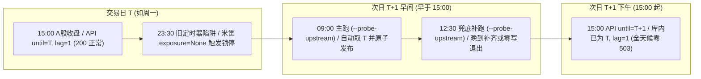

# 多用户持仓诊断 V1 后端发布切换指南

面向执行与复核多用户持仓诊断 V1 后端正式上线切换的运维与开发维护者。状态：**现行操作指南**（2026-11-24 已按本文完成云端 `/srv/getrich` 准生产切换与长期运维脚本收口）；本文提供可复用的部署结构、配置拆分、日更调度、服务加固与回退步骤。真实域名、公网 IP、密钥与供应商凭证仅在仓外维护，严禁写入仓库（见 [D-019](../../.agents/brain/DECISIONS.md#d-019)）。

接口调用契约见 [持仓诊断 API 调用指南](diagnosis-api.md)，版本锁与多品种共库边界见 [工程与业务关键点备忘](review-key-points.md)，数据库容器模板见 [deploy 说明](../../deploy/README.md)。

---

## 1. 切换前基线与红线预检

在切换 `/srv/getrich/current` 软链或开启 `GETRICH_DIAG_PUBLICATIONS_ENABLED=true` 前，逐项确认以下前置条件：

1. **数据库与迁移一致性**：PostgreSQL 18.6／TimescaleDB 2.30.1（named volume，仅绑定 `127.0.0.1:5432`，见 [D-004](../../.agents/brain/DECISIONS.md#d-004)）中 `ops.schema_migrations` 的 57 条迁移（`000`～`056`）与磁盘文件名称、SHA-256 完全一致；`_timescaledb_internal` 下不存在缺少 `diag_chunk_truncate` 触发器的普通表。
2. **当前诊断发布有效且新鲜**：`diag.data_publication` 最新记录（如 `diag-v3-20261120-daily-9ff71d632cb1e712`）满足 `contract_version = 'diag-publication-v3'`、`diag.publication_is_valid(data_version_id) = true`、14 个组成（13 个基础分区收据 + 1 个米筐 `v2` 风险五件套收据）在 `ops.diag_input_head` 中全部 `dirty = false`，且相对当前上海时间满足滞后不超过 1 个已收盘交易日（`lag <= 1`）。
3. **备份与供应商配额余量**：`/srv/getrich/state/backups/` 下存在最近一次成功的 `pg_dump` 滚动逻辑备份且 `pg_restore --list` 可读；米筐与 Tushare 账号剩余额度保留不少于 10%，且授权剩余有效期不少于 30 天。
4. **V1 交付范围冻结边界**：主前端 `apps/web` 与回测前端 `apps/backtest-web` 在 V1 冻结不部署；后端通过 `GETRICH_V1_DIAGNOSIS_ONLY=true` 收敛公开路由面（见第 3、5 节）。

---

## 2. 发布目录与构建差异（`app` vs `etl`）

`/srv/getrich` 将在线 API 运行环境（`app`）与数据采集发布环境（`etl`）物理隔离，经原子软链 `/srv/getrich/current/app` 与 `/srv/getrich/current/etl` 指向对应版本目录。**两者绝对不能共用 `--no-editable` 虚拟环境**：

| 维度 | API 运行副本（`/srv/getrich/releases/<id>/app`） | 日更与迁移副本（`/srv/getrich/releases/<id>/etl`） | 约束原因 |
|---|---|---|---|
| **源码形态** | 干净源码解包目录（无需保留 `.git`） | **必须保留 `.git` 的干净 Git 检出或 `git worktree`** | [`risk_receipts.py`](../../packages/gr-data/src/gr_data/db/postgres/risk_receipts.py) 中 `_checkout_root()` 调用 `git rev-parse --show-toplevel` 与 `git status --porcelain=v1 --untracked-files=all` 校验 `packages/gr-data/src/gr_data` 和 `packages/gr-db/src/gr_db/ddl` 无未提交／未跟踪改动 |
| **`uv sync` 命令** | `uv sync --frozen --offline --package gr-api --no-dev --no-editable` | `uv sync --frozen --offline --package gr-data --package gr-db --no-dev`（**严禁 `--no-editable`**） | `_checkout_root()` 强制断言 `Path(__file__).resolve()` 位于 `<git_root>/packages/gr-data/src/gr_data/db/postgres/risk_receipts.py`；若加 `--no-editable` 安装到 `.venv/lib/.../site-packages/`，所有生产日更会立即抛 `ContractViolationError` |
| **包含的一方包** | `gr-api`、`gr-signal`、`gr-backtest`、`gr-data`、`gr-tools`（不含 `gr-db`、`dev`） | `gr-data`、`gr-db`、`gr-tools`（不含 `gr-api`、`dev`） | 最小运行闭包；避免 `gr-api` 进程具备迁移入口，同时确保 `etl` 可执行 `gr-data` 与 `gr-db` |
| **进程启动方式** | 直接调用 `/srv/getrich/current/app/.venv/bin/uvicorn` | 直接调用 `/srv/getrich/current/etl/.venv/bin/gr-data` | 禁止在 systemd `ExecStart` 中使用裸 `uv run`（裸 `uv run` 默认尝试重同步全 workspace 与 `dev` 依赖，离线环境下会直接失败） |

**防隐式 `.env` 覆盖检查**：`load_environment()` 在未显式传入文件路径时会依次查找 `<project_root>/.env` 与 `~/.config/getrich/.env` 并作为底表加载（环境变量仍优先）。发布脚本须确保 `/srv/getrich/releases/<id>/{app,etl}/.env` 与服务运行用户的 `~/.config/getrich/.env` 均不存在，并在 systemd 单元中显式声明 `Environment=GETRICH_ROOT=/srv/getrich/current/app`（或 `etl`）。

---

## 3. 环境配置最小权限拆分与长期运维脚本收口

### 3.1 环境文件最小权限拆分（零密钥混放）

生产与准生产环境按**最小权限原则**将运行配置拆分为两份权限 `0600` 的独立环境文件（历史迁移阶段的 `maintenance-runtime.json` 1,897 文件哈希锁与旧 `operations/cloud-stage-*` 冻结目录已随正式切换整体下线，不再阻断日常配置调整与密钥轮换）：

1. **API 专用环境 `/srv/getrich/config/api-prod.env`（`0600`）**：
   - 仅由 `getrich-api.service` 通过 `EnvironmentFile=/srv/getrich/config/api-prod.env` 与长期巡检脚本 `/srv/getrich/ops/run-health.py` 读取。
   - **绝不写入 `TUSHARE_TOKEN`、`RICEQUANT_API_KEY` 等外部供应商密钥**。
   - 必配非敏感开关与路径示例（密钥与域名在仓外填入真实值）：

   ```ini
   APP_ENV=prod # 域名备案前准生产联调可设 APP_ENV=staging + STRICT_MODE=true
   STRICT_MODE=true
   TZ=Asia/Shanghai

   GETRICH_V1_DIAGNOSIS_ONLY=true
   GETRICH_DIAG_PUBLICATIONS_ENABLED=true
   GETRICH_ALLOW_MOCK_AUTH=false
   GETRICH_WORKER_BACKEND=inproc

   BACKTEST_ARTIFACT_DIR=/srv/getrich/state/artifacts

   WEB_HOST=127.0.0.1
   WEB_PORT=8001
   WEB_CORS_ORIGINS=https://<YOUR_FRONTEND_ORIGIN>
   CSP_POLICY=default-src 'none'; frame-ancestors 'none'
   JWT_SECRET=<REPLACE_WITH_STRONG_RANDOM_SECRET>
   JWT_EXPIRE_MINUTES=1440
   JWT_REFRESH_EXPIRE_HOURS=168

   PG_HOST=127.0.0.1
   PG_PORT=5432
   PG_USER=quant
   PG_PASSWORD=<REPLACE_WITH_PG_PASSWORD>
   PG_DB=getrich
   PG_POOL_MIN=2
   PG_POOL_MAX=20
   ```

   > **关键启动陷阱**：[`gr_api/config.py`](../../packages/gr-api/src/gr_api/config.py) 在 `APP_ENV=prod` 或 `STRICT_MODE=true` 时要求 `BACKTEST_ARTIFACT_DIR` 指向已存在的目录（即使开启 `GETRICH_V1_DIAGNOSIS_ONLY=true`，`load_api_settings()` 仍会构造 `BacktestStorageConfig`）。切换前必须先执行 `mkdir -p /srv/getrich/state/artifacts` 并赋予运行用户读写权限。若 ICP 备案完成前需使用本地前端源联调，`APP_ENV=prod` 会拒绝本地 `WEB_CORS_ORIGINS`，联调阶段保持 `APP_ENV=staging` 配合 `STRICT_MODE=true`。

2. **数据维护专用环境 `/srv/getrich/config/data-prod.env`（`0600`）**：
   - 仅由 `/srv/getrich/ops/run-v1-daily.py`（`getrich-v1-daily.service`）与 `/srv/getrich/ops/run-backup.py`（`getrich-logical-backup.service`）加载。
   - 仅保留 `GETRICH_ROOT=/srv/getrich/current/etl`、`PG_*`、`RAW_PARQUET_ROOT=/srv/getrich/state/raw_parquet`、`TUSHARE_TOKEN`、`RICEQUANT_API_KEY`、`TZ=Asia/Shanghai`；**不放入 `JWT_SECRET`**。
   - 逻辑备份脚本在快照事务内显式执行 `SET LOCAL idle_in_transaction_session_timeout = 0`（同时保留常规会话的 `10min` 悬挂事务保护），避免全库 `pg_dump` 超过 [`postgresql.conf`](../../deploy/config/postgres/postgresql.conf) 的空闲事务上限。

3. **统一长期运维脚本目录 `/srv/getrich/ops/`（V1/V2 通用）**：
   - `deploy-release.sh`：按 `app`（`--no-editable`）与 `etl`（保留 `.git` 的干净 editable 检出）构建并原子切换 `/srv/getrich/current/{app,etl}`。
   - `getrich-api.service`：API systemd 单元模板。
   - `run-v1-daily.py`：晨间 T+1 日更入口（互斥锁 `maintenance.lock`、独立日历对账、`--probe-upstream` 零写等待，日志落盘至 `/srv/getrich/state/logs/daily-runs/`）。
   - `run-backup.py`：每日 `03:30` 一致性快照 `pg_dump` + `pg_restore --list` 校验 + SHA-256 收据与滚动保留最新 2 份归档（支持 `--self-test` 快速验证）。
   - `run-health.py`：每 15 分钟只读巡检（校验 `api-prod.env` 权限与长期底线开关但不写死 `v1_diagnosis_only`、检查 `getrich-api.service` 与 `nginx.service` 存活、实测 `/health` 与 4 项安全头及外网 `/metrics` 返回 `403`、扫描 `/srv/getrich/state/logs/daily-runs/` 排查卡顿、开市日 `13:30`～`14:59` `pending_upstream` 提前输出 `warnings`，结果写 `/srv/getrich/state/health/latest.json`）。

---

## 4. 日更定时器改期与米筐 T+1 探针（消除 `23:30` 锁停与 `15:00` 过期 `503`）

### 4.1 为什么日更绝对不能只放在 `23:30`

两处代码门禁与米筐上游发布时间共同决定了调度窗口：

- **上游 T+1 延迟**：米筐 `v2` 的 `factor_return`、`covariance`、`specific_return`、`specific_risk` 在交易日 $T$ 晚间可能已有返回，但 **`exposure`（因子暴露）在 $T$ 日晚间返回 `None`，需到 $T+1$ 早间才发布**。
- **采集默认日界（[`diagnosis_daily/cli.py`](../../packages/gr-data/src/gr_data/diagnosis_daily/cli.py)）**：`last_closed` 在每日 `15:00 Asia/Shanghai` 从 `昨天` 切到 `今天`。`23:30` 无参运行默认请求 `今天`（$T+0$），导致 `exposure` 全空抛 `ContractViolationError` 并写出 `daily-blocked.json` 锁停后续日更。
- **API 新鲜度门禁（[`diagnosis_publication.py`](../../packages/gr-api/src/gr_api/services/diagnosis_publication.py) `require_freshness`）**：同样在 `15:00 Asia/Shanghai` 将 `until` 推到 `今天`，统计 `(as_of_date, until]` 内的开市交易日数 `lag`，**一旦 `lag > 1` 立即对所有新建诊断和 `/v1/diagnosis/options` 返回 `503`**。若仅把 `23:30` 任务改为跑 `昨天`（$T-1$），周一收盘数据要等周二 `23:30` 才入库，导致周二至周五每天 **`15:00`～`23:30`（8.5 小时）出现 `lag = 2` 的全站新诊断 `503` 故障窗**。



| 时刻（`Asia/Shanghai`） | 库内最新 `as_of_date` | API `until` | 开市日滞后 `lag` | API 状态与日更行为 |
|---|---|---|---|---|
| 周一 `15:00` ～ 周二 `08:59` | 周五 | 周一 | `1` | `200/201` 正常；等待米筐周二早间发布周一 `exposure` |
| **周二 `09:00`（主跑）** | 周五 → **周一** | 周一 | `1` → `0` | `last_closed` 自动取周一；`--probe-upstream` 探测就绪后原子发布周一版本 |
| **周二 `12:30`（补跑）** | 周一 | 周一 | `0` | 若 `09:00` 已发布则直接返回 `up_to_date`；若 `09:00` 上游延迟则在 `15:00` 前完成补发 |
| 周二 `15:00` ～ 周三 `08:59` | 周一 | 周二 | `1` | `200/201` 正常；无缝衔接下一交易日 |
| 周六 `09:00` / `12:30` | 周四（或周五） | 周五 | `1`（或 `0`） | 若米筐周六已出周五数据则当场发布；若等周一早间才出，`--probe-upstream` 记 `pending_upstream` 退出 `0`、不锁停，周末与周一上午 `lag=1` 接口始终正常，周一 `09:00` 准时发布周五 |

### 4.2 `getrich-v1-daily.{timer,service}` 推荐配置

`/etc/systemd/system/getrich-v1-daily.timer`：

```ini
[Unit]
Description=GetRich V1 Portfolio Diagnosis T+1 Morning Update Timer

[Timer]
OnCalendar=*-*-* 09:00:00 Asia/Shanghai
OnCalendar=*-*-* 12:30:00 Asia/Shanghai
OnCalendar=*-*-* 14:15:00 Asia/Shanghai
Persistent=true
RandomizedDelaySec=60
Unit=getrich-v1-daily.service

[Install]
WantedBy=timers.target
```

`/etc/systemd/system/getrich-v1-daily.service` 核心命令约束：

- `WorkingDirectory=/srv/getrich/current/etl`
- `Environment=GETRICH_ROOT=/srv/getrich/current/etl`
- 由 `/srv/getrich/ops/run-v1-daily.py` 加载 `/srv/getrich/config/data-prod.env` 并调用 `/srv/getrich/current/etl/.venv/bin/gr-data --config /srv/getrich/config/daily-native.yaml diagnosis-daily run --probe-upstream`：单股 `v2` `exposure` 未就绪时写 `{"status": "pending_upstream", "reason": "ricequant_v2_exposure_not_ready"}` 并以退出码 `0` 结束（不烧 83 批配额、不归档 `_failed`、**不生成 `daily-blocked.json`**）；仅真实契约违规或阶段 B 失败返回非零退出码并写 `daily-blocked.json`。
- `15:00 Asia/Shanghai` 之后如需手工补跑历史缺日，必须显式传 `--start <起始日> --end <米筐已发布的上一交易日>`。
- `/srv/getrich/ops/run-health.py` 对齐：存在 `daily-blocked.json`、`!publication_is_valid`、日更卡死超时或 `lag > 1` 判为 `alerts`（`passed=false`）；`pending_upstream` 且 `lag <= 1` 在开市日 `13:30` 前判正常等待，`13:30`～`14:59` 写入 `warnings` 提示提前人工核查。

---

## 5. `getrich-api.service`、反向代理与网络边界加固

### 5.1 `getrich-api.service` 标准配置要点

```ini
[Unit]
Description=GetRich FastAPI Service (V1 Portfolio Diagnosis)
After=network-online.target docker.service
Wants=network-online.target

[Service]
Type=simple
User=ubuntu
Group=ubuntu
WorkingDirectory=/srv/getrich/current/app
Environment=GETRICH_ROOT=/srv/getrich/current/app
EnvironmentFile=/srv/getrich/config/api-prod.env
ExecStart=/srv/getrich/current/app/.venv/bin/uvicorn gr_api.main:app \
    --host 127.0.0.1 \
    --port 8001 \
    --workers 1 \
    --no-server-header \
    --proxy-headers \
    --forwarded-allow-ips=127.0.0.1 \
    --timeout-graceful-shutdown 35
TimeoutStopSec=45s
Restart=on-failure
RestartSec=3s
NoNewPrivileges=true
PrivateTmp=true
ProtectSystem=strict
ReadWritePaths=/srv/getrich/state/artifacts

[Install]
WantedBy=multi-user.target
```

1. **显式绑定回环地址**：`uvicorn` 不自动消费 `WEB_HOST`／`WEB_PORT` 作为监听参数，必须显式传 `--host 127.0.0.1 --port 8001`。
2. **优雅停机超时（`35s` / `45s`）**：[`diagnosis_publication.py`](../../packages/gr-api/src/gr_api/services/diagnosis_publication.py) `consistent_read()` 含 `30s` `statement_timeout` 与 `5s` 屏蔽取消锁清理，设 `--timeout-graceful-shutdown 35` 与 `TimeoutStopSec=45s` 避免停机时被提前 `SIGKILL`。
3. **反向代理与路由收敛**：开启 `GETRICH_V1_DIAGNOSIS_ONLY=true`（[`gr_api/main.py`](../../packages/gr-api/src/gr_api/main.py) 仅挂载 `/v1/auth`、`/v1/user`、`/v1/diagnosis`、`/health`、`/metrics`，保留 4 个安全响应头并跳过 `BacktestJobListener`）；反向代理（Nginx 监听 `80` 与 `8080`）对外网返回 `403` 屏蔽 `/metrics`，对 `/v1/auth/*` 与 `POST /v1/diagnosis/snapshots` 限流；注意最严格纯 API 策略 `CSP_POLICY=default-src 'none'; frame-ancestors 'none'` 会拦截浏览器渲染 `/docs`（属预期安全行为，接口联调通过导出 OpenAPI 3.0.3 JSON 导入 Apifox 进行）。ICP 备案前维持 DNS 暂停与高位端口联调，备案后拆分为根域名／`www` 前端静态站与 `api.<domain>` 后端反代并切回 `APP_ENV=prod` + HTTPS。

---

## 6. 原子发布、上线复验与回退步骤

1. **切换顺序**：离线构建 `releases/<id>/{app,etl}` 并确认 `/srv/getrich/state/artifacts` 存在 → 在 `etl` 运行 `diagnosis-daily status` 核验 `valid: true` 并对 `api-prod.env` 执行 `load_api_settings()` 预检 → 更新 `getrich-v1-daily.{timer,service}` 为晨间窗口并 `systemctl daemon-reload && systemctl restart getrich-v1-daily.timer` → `ln -sfn` 原子切换 `/srv/getrich/current/{etl,app}` 并重启 `getrich-api.service`。
2. **深度上线复验（不以静态 `/health` 代替业务就绪）**：用真实受控账号核验 `GET /v1/diagnosis/options`（`200`、最新 `v3` 版本、7 项指标、4 个安全头）、三股样本 `POST /v1/diagnosis/snapshots`（`201`、幂等重放 `200`、`calibrated: false`）、未登录 `401`（`request_id` 与 `X-Request-Id` 一致）、跨用户 `403`、`/v1/backtest-jobs/backtest` 返回 `404`、外网 `/metrics` 拒绝访问，最后停用临时账号并确认停用账号登录被 `401` 拦截。
3. **异常回退**：仅关闭诊断读取时将 `api-prod.env` 的 `GETRICH_DIAG_PUBLICATIONS_ENABLED=false` 并重启 `getrich-api.service`（不影响日更与备份）；代码回退时将 `current/app` `ln -sfn` 指回上一版兼容 schema 的 `releases/<prev_id>/app` 并重启。严禁删表、逆改 `ops.schema_migrations` 或直接覆盖生产库；数据库恢复必须先还原至全新隔离库核对后再另审切换。
