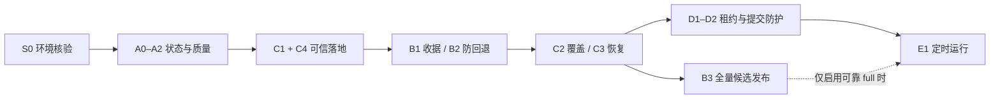

# gr-data 可靠采集实施计划

面向审核范围与顺序的维护者，以及后续实现者。状态：**通用协议仍待评审，Tushare 最低导入门禁与米筐风险模型 2a 已限定落地**；本文修订不授权新的实现、供应商调用、工作库迁移或部署。

核对日期：2026-10-28，静态核对源码、DDL、测试与已确认决策，检查本机解释器及测试依赖可解析；未运行业务测试、启动容器或连接数据库／供应商。2026-10-06 的审计结论仅作历史依据。

依据：[可靠采集方案](../../../getrich-design/data-platform/proposals/reliable-pipeline.md)、[历史实现审计](../../../getrich-design/archive/data-platform/reviews/2026-10-06-implementation-audit.md)、[一期数据集清单](../../../getrich-design/data-platform/portfolio-diagnosis-phase1-datasets.md)。相邻仓库链接用于本地双仓布局；当前采集进度见 [NOTES](../../.agents/brain/NOTES.md)，业务缺口见 [backlog](backlog.md)。

## 1. 当前基线与边界

成功标准是目标范围的质量、覆盖、提交结果和水位可核验，退出码为 0 只是一项信号。保留 raw → Parquet → ingest → PostgreSQL／TimescaleDB、单表单一来源、COPY／UPSERT 及现有 CLI，不另建行情主库或编排平台。

| 已有能力 | 适用范围与尚缺部分 |
| --- | --- |
| Tushare 最低导入门禁 | 已有损坏文件硬失败、所选月份必需分区检查、未知代码拦截、硬／软分级及失败流水；尚无统一 A0 状态模型、quarantine、完整开始记录／本地 spool，也未推广全部供应商 |
| 米筐风险 2a | 迁移 049 已提供 variant 用途、整包收据、run 绑定和观察级 capture／import 检查点；`factor.risk_bundle` 覆盖五件套及覆盖表。不是连续日期水位、通用 B1、B2 防回退或 B3 全量切换 |
| 米筐观察恢复 | 补充链路已有不可变观察、哈希、拆片及配额暂停；风险链路复用完整模型日，失败日以新 observation 重抓，不能声称已支持通用 chunk 续传 |
| CLI 提交结果区分 | 已有失败、软告警及提交后停止语义；米筐 ingest 的退出码 `4` 表示已提交但发布资格不满足，`5` 表示事务退出异常后暂停，结果可能已确认提交或仍未知，须结合 outcome 核对，不能一律记失败或宣称已回滚。具体以 [cli.py](../../packages/gr-data/src/gr_data/cli.py) 为准 |
| 认证边界 | [D-020](../../.agents/brain/DECISIONS.md#d-020) 已默认关闭 mock、限制仅 dev 显式开启，无效 JWT 不回退请求头；远端权限与网络边界仍需专项验收 |

原 S0“解释器失效、缺测试依赖”不再作为当前阻塞。S0 保留为每台目标机的前置核验；本次依赖检查不代表测试通过或服务可用。

**运行分工已确认**：iMac 为唯一正式采集／入库主端，Air 用于远程开发与隔离测试；迁移及切换仍待验收。存储、部署和备份目标按 [iMac 迁移计划](imac-collector-migration.md)核对，不在本计划重新选择主机或写入机器路径。

## 2. 实施顺序

保留原任务编号，按依赖推进，不再混用设计阶段编号和严重度。以下均为通用协议的剩余工作；涉及已有链路时先复用并验证兼容性。

B1／B2 的接口在 A0 定义，闭环依赖 C1／C4 的可信文件与分区身份。D、E1 不以 B3 为通用前提；首期可只开放逐分区增量／补数，可靠 full 在 B3 验收前禁用。既有 `--mode init` 不自动等同于全量原子发布。

### A. 环境、状态与质量

| 任务 | 剩余工作与落点 | 完成条件 |
| --- | --- | --- |
| S0 环境核验 | 使用现有 uv lock 核验解释器与依赖；逐项检查所选测试的 fixture 依赖。`tests/conftest.py` 的 `pg_dsn`／`pg_conn` 被请求时会启动容器、迁移并 TRUNCATE 隔离库，不能仅凭 marker 或环境开关认定离线 | 离线用例只依赖 Fake SDK／临时文件；PG 用例明确使用隔离实例，记录实际通过、跳过和未验证范围 |
| A0 契约冻结 | `cli.py`、`common/quality.py`、`ingest/base.py`；依赖 S0。区分 process_status 与 data_status，统一 run／attempt／partition 身份、expected／actual／rejected 计数、hard／soft 规则及退出码映射；选定首批 dataset | 合法空、未到发布窗口、部分覆盖、硬失败与提交结果未知可区分；兼容已有 CLI 调用方及米筐已提交后停止语义 |
| A1 质量推广 | `common/parquet.py`、provider adapter／importer；依赖 A0。推广严格读取与覆盖检查，损坏文件隔离并保留证据，build 丢行进入结构化质量结果 | 不将损坏当缺失；hard fail 拒写，soft 明确降级；source／accepted／rejected 可对账，未知代码和缺分区有定位信息 |
| A2 运行账本 | `ingest/__init__.py`、`ingest/base.py` 及 gr-db 迁移；依赖 A0。补独立短事务的开始、失败与真实耗时，覆盖 build／挂载／配置预检失败；PG 不可达时写有界本地事件 spool | 主事务回滚后仍有失败证据；恢复后幂等汇入。spool 仅存脱敏事件，不成为第二套采集计划、水位或业务提交账本 |

A0 的逻辑状态沿用设计 §6：process_status 包含 queued、running、deferred、raw_ready、importing、succeeded、partial、blocked、failed、abandoned；data_status 区分 complete、valid_empty、degraded、partial、waiting、blocked。迁移与现有状态映射需在实现前审阅，不直接替换现行数据库枚举或 CLI 约定。

### C. 可信落地、覆盖与恢复

| 任务 | 剩余工作与落点 | 完成条件 |
| --- | --- | --- |
| C1 raw-first 标准化 | `raw/ricequant/{store,riskmodel,risk_dynamic}.py`、`common/{parquet,paths}.py`、Tushare fetcher／adapter；依赖 A0。版本化 manifest，登记身份、精确范围、aware 时间、质量、文件哈希／schema、分页拆片及 producer 版本，字段定义见设计 §5.1。Tushare 新格式采用不可变日分片，月文件降为可重建兼容视图 | 同文件系统临时写、文件 fsync、校验读回、不可变路径发布、目录 fsync，最后持久化 manifest；孤儿／partial 文件不可消费。旧 raw 保留，缺字段不能伪造完成证据 |
| C4 存储保护 | `common/paths.py` 与运行预检；依赖 A0，与 C1 同批。核验 storage_id、sentinel、realpath、挂载及容量；本地 spool 单独设有限目录 | 外盘未挂载、错误卷、路径越界或空间不足时拒绝写入，不在系统盘创建同名替代目录，不删唯一证据；在实际文件系统验证 rename／fsync／锁语义 |
| C2 覆盖与模式 | raw planner、provider fetcher；依赖 C1、B2。明确 full／incremental／backfill／reconcile 的范围，按交易日、生命周期、分页与发布截止识别洞集；标的和日历只有完整 scope 才可差集删除／撤销 | 最新分区存在也能发现旧月缺日；未发布、合法空、截断与缺数可区分；历史修订有新观察及影响范围。停复牌空响应与整月时间刷新问题纳入此阶段 |
| C3 replay 与预算 | raw 入口、米筐轮次／journal、ingest manifest 消费；依赖 B1、C1、C2。扫描已落地未 receipt 的观察，复用链路允许的完整单元，明确失败日／片的重试边界，按端点与账号控制预算 | 文件成功库失败只重导；已完成单元不重复耗费额度；恢复不丢原失败证据。现有风险专用执行器的人工复核暂停不得被通用调度绕过 |

C1 上线前核算不可变观察的增长及保留预算；清理协议未验收前不删除唯一副本。日线／分钟保持不复权主存，复权修订关联数据版本；财报保留发布、观察及修订时点。分钟／财报及尚未准入 writer 的启用不包含在本计划中。

### B. 收据、防回退与发布

| 任务 | 剩余工作与落点 | 完成条件 |
| --- | --- | --- |
| B1 通用收据与双水位 | `db/postgres/risk_receipts.py`、`ingest/base.py`、`db/postgres/copy.py` 及 gr-db；依赖 A、C1、C4。推广 `(target, manifest_hash, importer_version)` 收据，业务 merge、质量、receipt 与 DB 检查点同事务，capture 独立提交；预留 E4 outbox 的原子写入位置 | 同批重放不重写业务；COMMIT 响应丢失按收据核对，确认前不假定回滚或自动继续；观察级检查点与连续完成水位分开 |
| B2 观察版本防回退 | 导入层及代际／分区当前指针；依赖 B1。显式登记 authority epoch、代际顺序与 canonical 分区观察序，事务锁定当前版本并 CAS；不能按 UUID、mtime、到达顺序或不同 variant 的局部序号比较新旧 | 新 B 提交后旧 A 晚到，仅保留历史／记 superseded，不改当前业务值与水位；异地端采用同一权威顺序 |
| B3 可靠 full（可选） | raw planner、候选 staging、发布服务及 gr-db；依赖 B1、B2、C1、C2。冻结 generation，全部必需分区通过后一次发布；评估锁、WAL、峰值空间与读契约，大分钟 full 另审 | 任一片失败，旧可用业务数据不变；发布失败可重放，无半激活代际。未实现时拒绝可靠 full，逐分区 backfill 不宣称全量原子性 |

**先核对现有 DDL，再设计通用扩展。** 2026-10-29 新库已将风险专用 variant／receipt／checkpoint 归入 `factor`，037 直接建表，049 完成证据触发器；`factor.import_receipt.target` 仍限定 `factor.risk_bundle`。现有记录与 variant、capture、run 绑定建立不可变约束，不直接放宽为全部 provider 的通用收据。通用协议须另审键、状态、公共与领域校验边界及兼容迁移，不能把风险表原样复制后宣称通用。全部 DDL 只放 gr-db，后续不改已部署的基线 SQL，不在 API 启动时建表。

**诊断发布另按 [D-022](../../.agents/brain/DECISIONS.md#d-022) 的 2b 验收**：发布清单钉住组成收据／run，失效与组成写入原子衔接，统一读取在一致性快照内核对；数据库层拒绝 validation run，消费 `publishable=false` 的旧 run 禁用证据。组成变化后旧版本不可复算，不以当前最新数据冒充历史版本；一期不建可变数据版本表，诊断专用角色延后。B2 当前指针、B3 全量切换和诊断发布不是同一能力，正式风险读取保持关闭。

### C2b. 诊断发布与一致性读取（2026-11-10，限定首版已发布，正式读取待验收）

读者：审核诊断数据契约及实现边界的维护者。2026-11-09 用户批准隔离端到端验收后，另批准工作库定向执行054，现结构验收已通过；2026-11-10又获准完成限定首版收据登记与发布，**启用正式读取仍待单独决定且须先落实范围校验**。下文保留已批准设计，实际实现差异及结果见本节末尾。051 只增加诊断字段和口径版本，不完成本节。沿用 D-022：当前行情表仍可 UPSERT，旧报告保留产物，失效版本不保证重算，不建设全量历史行版本存储。

#### 一个版本固定什么

发布的是完整、不可变的清单，而不是“当前最大交易日”。拟以现有 `diag.data_version.data_version_id` 为唯一标识，快照的 `data_fingerprint`、计算缓存键及所有方案均引用它。现有 `snapshot_at` 固定为发布取数截止时刻，另保存明确 `as_of_date`、协议版本、发布序号和组成清单哈希；哈希由组成身份计算，不在请求路径扫描行情内容。

以首批三股的目标日 **2026-11-05** 为例，清单至少固定：

| 组成 | 必须固定的身份／范围 |
| --- | --- |
| 证券主数据与代码映射 | provider、已验收观察／导入收据、覆盖证券范围及生命周期规则；不是查询时最新名称或别名 |
| XSHG／XSHE 日历、日线／复权、停牌事件及覆盖 | 每个参与分区的收据；历史窗口2025-10-23～2026-11-05及前一开市日；停牌覆盖的合法空证据也属于组成 |
| 当日估值与资产分类 | 数据日期、实际可用时间、来源收据与有效区间；晚采集历史观察不包装成历史 PIT |
| v2 风险模型 | model_id、2026-11-05、run_id `da212baf-9bfc-5014-8bff-0b574e8e7b9b`、variant_id、原子receipt_id、因子轴hash、daily预测期限、F／特异方差的单位及单位证据版本 |
| 可用选项／指标 | 已验证行业体系、全收益基准和启用指标；行业／ROE／Beta／回放尚未准入时明确留空／不可用 |

“可用版本”需所有声明必需组成通过门禁；缺少非必需指标的数据不妨碍基础指标发布。若发布了仅基础指标版本，不能之后原地补入风险run，须发布新版本。风险库存完整与单日准入、`calibrated`、正式发布分别存证；单日准入不能自动变更数据库校准标记。

#### 待审阅的 schema 改动

全部 DDL 仅放 gr-db 的新增迁移，编号实施时按当前仓库分配，不改已记账 037／049／051／052。以下对象已实现于新迁移054；隔离库及工作库结构均已验证，**工作库六表仍为空，尚未发布或启用**：

| 拟新增对象 | 关键键、字段与约束 |
| --- | --- |
| `ops.diag_input_receipt` | 面向诊断基础数据的窄收据；UUID主键，dataset_key／partition_key／provider、观察与raw manifest hash、importer版本、覆盖日期／样本范围、quality、committed_at。不可变、重放业务键唯一；与 canonical 写入同事务。不是宣称通用 B1 已完成，风险仍引用现有 factor 收据 |
| `ops.diag_input_head` | PK(dataset_key,partition_key)；当前基础receipt_id，或风险receipt_id＋run_id，两者CHECK互斥；dirty状态和修订标识。外键及触发器校验分区、归属与收据一致。修订标识用于相等性判断，不代替供应商权威顺序 B2 |
| `diag.data_publication` | data_version_id为PK／FK；as_of_date、published_at、publication_seq、manifest_hash、contract_version，发布后不可变；与现有snapshot_at／available_options一致性校验。旧种子版本无此行，不能冒充已发布版本 |
| `diag.data_version_component` | PK(data_version_id,dataset_key,partition_key)；固定日期范围及基础receipt_id或风险receipt_id／run_id，CHECK互斥、真实FK、不只存松散JSON。风险FK指向现有binding；触发器验证run、receipt、variant、日期、轴和provider全部匹配，拒绝validation用途 |
| `diag.data_version_invalidation` | append-only失效事件，版本FK、原因、受影响组成、触发的新收据、失效时刻；同一变更幂等。状态由失效事件推导，不把原发布清单改写成新组成 |
| `factor.risk_run_admission` | 不可变的目标run准入证据：run_id／receipt_id真实FK、适用日期与指标、因子轴／单位证据、检查结果、验收源码、授权依据与适用持仓范围；首批以全部非零证券ID和精确权重的规范化hash固定三股组合，读取时逐项匹配。与model_run.calibrated分离；当前三股证据不能扩为全市场或L4已验收 |

发布清单必须消费风险run既有拒绝／禁用证据，不能只检查receipt的publication_eligible。2026-11-09只读确认：既有证据在 `ops.data_quality_check`，rule=`risk_bundle_publishable`、detail.factor_model_run_id匹配run、detail.publishable=false；旧run `4cc48d3d-663a-5fc9-be51-17548ec23966` 仍有禁用记录（当前check_id=53572，不能硬编码旧历史文档中的37）。发布和读取均拒绝任何命中禁用证据的run，后加true不得覆盖原false。新增这类禁用事件也必须取得写入屏障并同事务失效引用版本；拟增加只针对这些证据的不可删除／不可改真保护和失效触发器，其他质量记录规则保持。无须臆造或迁移一张“已有禁用表”。

单表单一来源与质量门槛仍适用：生产清单拒绝validation run；原候选／完整计数满足 complete×1000≥candidate×999 且candidate>0、身份／上市边界未知为0；每个具体组合另要求全部非零持仓有效。首批risk_run_admission只能覆盖已验收的固定三股及已核指标，若要扩大证券范围，先扩验收证据，不由API默许。

#### 更新、失效与发布的原子关系

1. 采集／raw准备在事务外。导入器获得诊断输入写入屏障，按固定顺序锁定涉及的head，重新核对来源和预期当前修订；不接受旧观察覆盖新观察。尚无可靠来源顺序的修订需独立审定，不能把递增数据库ID当成供应商版本。
2. **同一 PG 事务**完成 canonical 修改、不可变收据、head切换、所有依赖旧head的版本失效及检查点更新。任一步失败全部回滚；提交响应丢失按唯一收据查询，不盲目再写。完全相同的已验收收据重放不写业务也不产生新失效。
3. 不完整批次只使对应head为dirty并失效旧发布，不能同时宣称新版本可用。发布程序取得同一屏障，确认全部必需heads干净、收据和业务覆盖通过后，一次插入data_version、publication和全部components。并发更新不能在清单校验与提交之间穿插。
4. 参与诊断的canonical表须有数据库写入防护：绕过受控importer的INSERT／UPDATE／DELETE／TRUNCATE也会获取屏障，并在同一事务把受影响head标dirty、追加失效；不能靠某个CLI自觉调用。实施前逐表列清单、检查Timescale触发器行为和批量导入性能。不修改凭据或引入新数据库角色；专用角色仍按D-022延后。
5. 新请求只查看“最新一次正式publication”，再核验其失效状态及全部head；最新版本失效时返回不可用，**不自动回退到更旧日期**。旧报告仍读原payload；对失效版本的/recompute返回409，不能用当前行情冒充旧版数据。

初版可保守地对参与表的任意写入失效整个数据集，减少漏判风险；缩到精确分区必须经过边界测试。更正日历、别名、停牌覆盖和估值同样触发失效，不能只覆盖行情和风险五表。

#### 一次诊断如何始终读取同一版本

拟用**一个诊断输入屏障**简化一期并发：诊断取共享屏障，输入写入和发布取排他屏障。只在短暂PG取数／计算／保存阶段持有，供应商网络调用和raw下载绝不在屏障内。性能不足时才另审分区锁，不预先引入调度系统或Redis。

具体拟使用固定命名空间的PG advisory lock：读请求先在尚无事务的专用借用连接上获取session级共享锁，**取得锁之后才开启 REPEATABLE READ 事务并建立快照**；写入／发布事务获取同一键的transaction级排他锁。不能先开启旧快照，再等待共享锁，否则可能读取已失效版本。session锁在成功、失败、取消、超时路径均须显式释放；无法确认释放就销毁连接，不归还池。此选择需实现真实并发／取消测试后才能启用。[PostgreSQL锁语义](https://www.postgresql.org/docs/18/explicit-locking.html#ADVISORY-LOCKS)、[Repeatable Read快照语义](https://www.postgresql.org/docs/18/transaction-iso.html#XACT-REPEATABLE-READ)。

取得快照后只解析一次publication，构造不可变的 `PublishedDiagnosticContext`：version_id、as_of、published_at、各分区receipt、风险run／单位／轴、available_options及指标准入。所有方案、代码解析、估值、历史收益和模型读取都使用同一上下文与连接；禁止函数中重新“取最新版本”、新开连接或用now()作数据截止。缓存查找和幂等重放也必须遵守失效／原产物契约。连接必须是事务空闲状态；不能复用认证查询已开启的事务，也不能为了切隔离级别擅自提交调用方事务。发布截止时刻在取得排他屏障后一次取数据库clock_timestamp并固定，不用进入等待前的事务起始时间代表发布时刻。结果及snapshot在同一事务保存，commit后释放共享锁；期间输入writer等待，不能一半持仓读取旧观察、一半读取新观察。

数据日期与实际可用截止分别过滤。published_at过滤不能恢复被UPSERT覆盖的旧值；旧版本失效后不再取数，只展示已保存产物。数据库屏障防护必须覆盖全部参与writer，未覆盖路径存在时不发布生产版本。

#### 待审阅的代码／API 改动

- **gr-data**：新增诊断专用发布命令／服务和窄收据支持；输入writer接入原子更新／失效协议。发布从独立命令运行，不放API启动或worker定时逻辑；迁移只建结构，不自动发布数据。
- **gr-api内部**：新建统一读取上下文，替换get_data_version的无条件“最新行”、所有now()截止及_base_data_version_available的固定False；诊断连接管理接入共享屏障／REPEATABLE READ。_load_risk_model只按固定run取数，校验整套binding、准入和全非零持仓，不找近邻日期或其他模型。
- **HTTP／类型**：保留现有路由；/options返回已发布version与明确as_of、可用指标；/result和/report元数据增加publication状态、失效原因及model run／units evidence／calibrated披露；/recompute失效409，无可用发布503。新增响应字段和错误码需要同步Pydantic、src/types及src/api，不能静默修改契约。幂等重放可返回原产物但必须标明当前不可重算。
- **波动率契约**：现有纯计算volatility是年化小数，不能把其值静默改成日度。拟保留原年化值，增加明确命名的daily_prediction_volatility／annualization_days，或另审显式horizon字段。读库仅将pct2_annual／10000恢复年化小数方差，特异方差不再平方；日度仅／252一次。
- **calibrated=false准入**：保留该事实并将已明确授权、目标run／指标／持仓范围内的单日结果标degraded，附“全区间未校准”；没有相应单日admission仍不可用。该策略须作为发布／API方案审阅，不在本轮开启。全区间五表与P6独立推进，不阻塞051，也不因单日放行被标为已完成。

#### 实施后必须通过的验收

固定三股40%／35%／25%、v2／2026-11-05、既有run与48因子轴，经正式读取链复现年化方差0.04532912929206873和单日预测波动率 **0.01341184167781401（1.3411841677814011%）**。数值比较采用已有rtol=1e-12、atol=1e-15；raw与REAL存储量化另按已登记容差验收，不能用放宽容差掩盖重复平方／重复反年化。

隔离库必须覆盖：更新和失效任一处失败整体回滚；更新在读取前／读取中／结果提交前的三种交错；发布时组成变化；最新版本失效不回退；旧版本重算409而旧产物可读；缺任一非零持仓即阻断模型；validation／禁用run拒绝；同收据重放与COMMIT响应丢失；取消／异常后session锁不泄漏；绕过importer的SQL触发失效；stock／calendar／suspend／valuation任一组成变更均能失效。现有认证和四个安全响应头继续由TestClient验证。实际执行范围、结果与维护边界见下文；未执行的维护路径不冒称已通过。

#### 实现差异与隔离验收（2026-11-09）

051按原记录结项，不再重跑。新增 `054_diag_publications.sql`，SHA256=`74402ad41171eff115dc70b90ad246b420860c213043f1967e470687967288a9`；新增6张收据／head／发布／组成／失效／单日准入表，真实外键、不可变保护及延迟完整清单校验；旧迁移不改。基础组成扩为11项（含classify.scheme），一个版本最多一个风险run。新增准入集合进入manifest，任何新增准入同事务失效旧版本，不能原地扩大范围。

gr-data提供独立async发布服务，调用方持有事务；canonical写入、收据及head切换与失效原子提交。API用一个不可变上下文固定日期、run及截止。POST在建立RR之前另取短事务串行session锁，避免幂等／计算缓存等待后的旧快照竞争；GET共享并发。锁以非阻塞探测等待（50毫秒间隔、总上限10秒），AnyIO shield下限时5秒清理，不能确认则销毁连接。AnyIO改为直接依赖，既有锁文件包版本不变。

Timescale父表statement及chunk行级保护之外，现有内部普通表安装TRUNCATE guard；正常写入事务局部启用Timescale DDL event，为未来chunk安装同样guard。缺少guard的内部表会使版本不可用，不能静默继续。创建event trigger需要超级用户。**DROP／drop_chunks()／retention路径尚未纳入该协议；本轮受保护日线未配置retention，工作库启用此类维护前须单独审阅并补屏障／失效防护，不能宣称覆盖任意DDL删除。**

隔离库 `getrich_diag_2b_20261109` 基线000～053加054，共55条账本；输入为工作库只读复制的固定三股真实数据、原run及完整覆盖证据。基础收据明确标记为隔离canonical快照受控接纳，固定实际指纹、归属和先前验收材料，不伪称补齐供应商历史导入收据；工作库首次接纳须另外审阅。范围仅固定三股40%／35%／25%的年化方差、年化／单日波动率；`calibrated=false`如实降级，L4、Beta等未扩标。

| 实际场景 | 结果 |
| --- | --- |
| POST诊断及GET结果 | 年化方差0.04532912929206873、单日波动率0.01341184167781401；原rtol=1e-12／atol=1e-15精确通过，年化字段保持原义，report另列单日卡 |
| 行情／风险在诊断中更新 | 两种真实writer均等待共享屏障，请求使用原版本且数值复现；更新后旧report 200、重算409、无可用发布的新诊断503 |
| 超时／取消 | writer占锁时HTTP超时；持有两把session锁时取消：0残留锁、0活跃池事务、0新快照；被取消连接安全丢弃后池恢复2/2，后续HTTP201 |
| 重复请求 | 同UUID并发200＋201且同snapshot；不同UUID同计算并发201＋201、仅一个计算产物 |
| 回滚／重放 | 行情及失效回滚、写回调失败回滚，原值／head／可用性均恢复；同收据不执行write，重复发布不增行 |
| 禁用／范围 | 原禁用证据保留并拒绝；另对原本可发布的匹配run/receipt添加禁用证据即拒绝、回滚恢复，隔离禁用条件的效果；新增scope使旧版本失效，回滚恢复 |
| 绕过SQL | 不完整publication提交被拒绝；既有chunk直接TRUNCATE立即失效，未来2031分块自动取得guard；探针全部回滚 |

风险数值读取使用binary协议保持REAL精确提升值；初轮文本协议导致的细小差异已修复，没有放宽容差。最初payload原因码遗漏和取消锁等待失败均保留日志。独立只读审查发现的RR竞争、准入扩范围和旧口径误消费forward已修复并复核。实际证据在本机验收目录 `diag-2b-20261109`：`http-acceptance.json`、`actual-result.json`、`cancellation-acceptance.json`、`concurrent-repeat-acceptance.json`、`database-acceptance.json`、`chunk-guard-final.json`、`final-database-check.json`及封存清单。Python定向152项通过、1项显式隔离测试默认跳过；该真实REAL协议测试另指定隔离库实际通过；迁移安全检查、Ruff、定向类型及前端lint/build通过（构建有既有大chunk提示）。

#### 工作库定向迁移与恢复方案（已审阅；054结构验收完成，首版发布另审）

1. 独立窗口确认目标getrich／system_identifier=7701306429122666534／OID=16384，051验收账本、全部现有账本、054文件SHA及未记账状态；052的磁盘／旧账本差异仍保留，不运行全目录迁移。核对Timescale版本、event trigger超级用户能力、参与表及既有维护策略；若不符停止。保持 `GETRICH_DIAG_PUBLICATIONS_ENABLED=false`。
2. 暂停相关canonical写任务和诊断写入，等既有备份／长事务自然结束，不杀会话。逻辑备份全库并以隔离恢复读回验收，同时记录diag／ops账本及相关来源、run和calibrated快照；不复制数据目录。备份未正常完成不升级。
3. 在单个迁移事务中设10秒lock_timeout、有界statement_timeout，核对目标与账本，通过 `PostgresMigrationExecutor.apply_one`仅执行固定054。锁超时整体回滚，采样实际blocker并等待下一窗口，不能连续重试或终止其他任务。
4. 新连接验证6表、FK／CHECK／不可变触发器、完整清单约束、父表和所有当前chunk的guard、未来chunk回滚探针、054唯一记账、旧051／052全字段及calibrated保持。此步骤只完成schema；不得据此发布或开启读取。
5. 首版发布另经审阅：在同一写入屏障内，按固定三股及历史窗口逐项核验实际组成、来源归属和raw／受控接纳证据，登记目标run／scope准入，单事务创建首个版本。严禁直接把隔离库测试收据当作工作库来源证据。工作库实际接口复验数值与200／409／503及取消后再单独批准开关，逐日准入限制继续生效。
6. 提交前任何失败由迁移事务回滚，确认054无账本且原schema／账本一致。提交后验收失败：开关保持false、暂停新发布，保留迁移与失败收据，优先审阅前向修复；不得自动删新表、清空失效事件或逆改账本。需要恢复时，将已验收逻辑备份恢复至全新隔离库，核对源身份／账本／业务指纹后另审工作库恢复或切换方案；禁止直接覆盖当前库或回写旧行情。启用后运行期故障先关闭读取配置并回滚应用至兼容旧入口版本，旧报告产物保留，schema及证据不自动回退。

#### 054工作库执行结果与首版材料（2026-11-09 21:25上海）

按用户批准的固定SHA，通过apply_one仅执行054，未跑全目录、未改052。现场getrich／system_identifier=7701306429122666534／OID=16384，TimescaleDB2.30.1及超级用户能力匹配；受保护表无retention/drop_chunks策略，内部作业日志保留与非参与realtime.tick_buffer保留单列，不改策略。事务锁暂停canonical与诊断写入，全库逻辑备份9,869,314,005字节，SHA256=`7bba181c0103e95ca3967e18c6dab91afea3b9f7f757fda9c7382225f25d8a0d`；全新隔离恢复成功，103张业务表行数、54条原账本、11633个校准标记及固定run／三股风险输入逐值读回一致，备份二次hash通过后才提交。全程无锁超时或实际blocker，未终止其他任务。

新连接将六表字段、83项约束、63个相关触发器及diag函数定义与已验收隔离结构逐项匹配；178个当前内部普通表／分块均有启用的TRUNCATE保护，2046-11-06未来分块探针取得保护并完整回滚、原分块清单恢复。054唯一记账，原54条账本全字段含051／052不变；旧数据版本、口径和calibrated保持，六表0行，配置开关false。账本applied_at沿用执行器NOW()，记录20:45事务开始时刻；实际提交与新连接验收时刻另存commit-receipt／fresh-validation，不改写账本时间。

首次准备脚本因空参数占位符错误在备份／迁移前停止并回滚，原失败证据保留；修正后attempt-02完成上述全流程，不覆盖失败记录。SQL原文、迁移前后完整账本、全库逻辑备份及恢复／验收／监控证据按长期保留封存，禁止自动清理；定位见NOTES。

首版发布材料仅准备、未写工作库：固定2026-11-05／米筐v2／run `da212baf-9bfc-5014-8bff-0b574e8e7b9b`，真实风险receipt `3dba53db-754b-5fbd-b492-e2c1f9376b85`，原variant、raw manifest和五文件哈希已核验。600519.SH40%／600036.SH35%／000333.SZ25%，759条bar、3条估值、253个停牌覆盖日及全非零持仓通过；仅年化方差、年化／单日波动率，binary复现0.04532912929206873／1.3411841677814011%，calibrated=false。

当时材料标记publication_ready=false：11基础dataset尚无工作库诊断收据；标准raw根缺2026-11的daily／adj_factor／daily_basic／suspend_d四份月文件，现有Tushare ETL日期列空，不能冒称目标日收据。现有库值与原验收证据可供下一轮受控接纳审阅，不生成假UUID或套用隔离receipt。meta.symbol_map六行来自两provider，接纳需按来源分区；行业三表为空且无归属，行业选项不准入。发布、创建head／admission及开启读取均须下一轮明确决定。

#### 工作库限定首版发布（2026-11-10）

用户定位并批准复用approved-v4-20261106/tushare-tail原件后，四份11月raw与原working验收及final封存哈希链通过；62份raw／覆盖文件及元数据、风险证据都已核对。759条bar和759条复权因子、三股当日3条估值、两个交易所760条日历及完整253开市日覆盖通过。三股停牌事件0行不是缺采：每个开市日coverage的raw_sha256、observed_at和requested_dates均与真实分区和sidecar一致。估值仅1项既有float缩放相对Decimal差异（招行circ_mv差−0.0001元），精确复现原已验收导入转换，未修改canonical或放宽风险容差。

排他发布锁内重新逐项核raw、全部11基础数据指纹、原风险run／真实receipt和精确三股范围，辅助复权表加ShareLock，导出发布前小逻辑备份。一次事务登记12份活动基础收据（symbol_map按tushare和ricequant两provider分区）、同一风险head及单日三指标准入，发布13组成清单。三张行业表全库0且无归属，用明确的internal_scope_absence_audit空组件收据存证，不冒称供应商分类覆盖，行业选项保持关闭。基础收据属于有真实源证据的当前观察，不包装成历史PIT或旧供应商导入UUID。

最终有效版本 `diag-v2-20261105-3stock-20261110-v2`；目标日2026-11-05，v2原run `da212baf-9bfc-5014-8bff-0b574e8e7b9b`、真实risk receipt `3dba53db-754b-5fbd-b492-e2c1f9376b85`，茅台40%／招行35%／美的25%，portfolio hash=`213db1e4663d966e3aa3376064d88204bb605fb762a78ac4f9e53b2aeb5a1db2`。准入仅annual_variance／volatility／daily_prediction_volatility，年化方差0.04532912929206873，单日波动率1.3411841677814011%，calibrated=false，不扩L4／Beta等指标。

首次提交v1时，估值组成误沿用历史窗口起点；复核后未修改不可变记录，而是追加仅2026-11-05的估值收据、head CAS revision2、原子失效v1并发布v2。旧v1及旧估值收据长期保留；当前v2的估值／风险范围仅目标日，其余历史组成覆盖2025-10-22～2026-11-05（含252收益日前一日）。新只读连接验证版本有效、13组件／12活动基础收据、原run／scope／指标及manifest重算，canonical、55条账本和11633个calibrated标记全部保持。定位与证据见NOTES的diag-first-publication-20261110记录。

正式API配置仍false，未创建诊断快照。**启用前必须让基础读取强制校验available_options.publication_scope中的精确组合和三指标，补隔离拒绝越界验收后再决定开关**；当前仅风险admission强制组合hash，不能把该限定版当全市场基础数据许可。此门禁不影响本次按授权完成数据发布及读回。

#### 多用户 V1：证券清单准入与工作库执行门槛（2026-11-10）

状态（2026-11-10）：用户确认隔离API验收并单独批准工作055及5224范围发布后，工作库迁移、新连接读回和独立于网页的真实HTTP验收均已通过。限定日期/证券范围/三指标已具备多用户正式API开放条件，常规开关仍false，启用由用户决定。本轮交付仅后端API、依赖迁移及数据发布；停止产品前端开发，不部署网页，既有apps/web改动保留另审。

PA-01～PA-03沿用沪深A股、每方案100原始行/一次5方案。前端UTF-8 CSV/TSV/TXT导入及手工编辑都提交完整组合至原POST /snapshots；Excel可另存CSV，不引入表格依赖。空权重全等权、全填权重归一化、重复合并及非法输入规则沿用原契约；零权重/重复行仍占原始行数。两套权重需同版本时一次提交两方案，修改后新POST，不原地改历史快照。建议权重列V2。

新增055 `055_diag_universe_admission.sql`，SHA256=`9e9ee63adbb80e82a39a319e7acf6812d5d0a9c71d6e90519a9eb88dc98aa23f`。仅新增 `factor.risk_universe_admission` / `factor.risk_universe_member`，以及发布协议CHECK、准入/成员不可变保护和提交时清单一致性约束；不改已记账051/052/054，不改canonical或calibrated，不自动发布/启用。头部清单按升序证券ID hash，不含权重；真实FK、同事务成员完整性及创建事务限制保证不可提交残缺或事后追加清单。新协议为 `diag-publication-v2-universe`，旧 `diag-publication-v1` 仍按精确权重hash解释。

范围固定2026-11-05、米筐v2、run `da212baf-9bfc-5014-8bff-0b574e8e7b9b`、原receipt `3dba53db-754b-5fbd-b492-e2c1f9376b85`。逐只核验5224证券（上交所2318、深交所2906）的included、48因子暴露、特异方差及最终F；源文件到库的REAL量化逐值一致。基础11项完整窗口2025-10-22～2026-11-05审计通过：1,308,660行情行、10,453映射（含5个合法历史别名）、760日历行、253日停牌采集覆盖、2709事件、5224分类、每证券截至目标日的估值观察，行业三表为空且对应选项关闭。67份基础raw/覆盖文件复核，历史缺价13,012键分别解释为上市前10,870、全日停牌2127、同日停复牌顺序未知8及有采集覆盖但来源无报价/无事件7；最后15键影响历史收益指标，不补值、不阻塞本次模型三指标。目标日7只无行情/同日估值均有全日停牌和采集覆盖，风险输入完整；滞后估值按实际日期披露。

API按publication_scope固定日期、指标和所有正权重证券，清单内自由组合不逐组合登记。未知/范围外清单证券仍保留输入权重与原因，完整组合三项风险不可用，不在已覆盖子集重归一化；ETF/北交所/非法权重/越界指标按422。结果另列annual_variance及daily_prediction_volatility，原volatility保持年化小数语义，回显日期、版本、run、模型及完整覆盖。calibrated=false标degraded，解释为指定单日证券清单与三指标数值验收，不等于全区间/P6。缓存键在已发布路径加入完整原始分母作用域；旧共享载体兼容保留。用户身份校验与已有四安全头保留，账号切换取消旧请求并清空私有前端状态。

实际隔离HTTP经真实登录验证：不同持仓、同股调权、文件/手工完全一致、两方案同版本、5×100行独立资产协方差路线在rtol=1e-12/atol=1e-15内一致；三股40/35/25年化方差0.045329129292068726、年化预测波动率0.21290638621720281、单日0.01341184167781401。两用户读取result/report及recompute越权均403；负/混填/NaN/Inf/全零/超行/超方案/ETF/BSE/越界指标/错日期均422。未知20%时model_coverage和data_quality覆盖均80%，完整风险不可用。真实055成员/幂等/轴/缺证券/回滚4项通过。受控两股清单中提交美的25%：逐项返回outside_security_universe、覆盖75%、完整风险不可用；旧report200、旧重算409、无有效发布POST503。事务内禁用原run后新准入被数据库拒绝，探针全部回滚；最后恢复5224全清单隔离发布并复现原三股数值。真实浏览器9场景通过、0页面异常，导入/手工/调权/两方案/退出清空及B用户不同组合均有截图；CUA原生文件选择器失联的失败证据保留，已用独立Playwright Chrome完成全流程，未接触用户浏览器profile。最终定向单测179passed/2显式PG默认skip，另显式隔离PG4项及V1真实读取19项实际通过；解析7项、lint/build、迁移lint通过，既有构建大chunk提示保留。

工作库只读预检（2026-11-10）：getrich / OID16384 / system_identifier7701306429122666534；55条原账本、旧三股v2有效、0持仓快照；全部基础指纹与binary风险逐值保持，67份raw hash保持，055未记账/两新表不存在。证据根 `/Volumes/myssd/data/getrich-validation/diagnosis-v1-multiuser-20261110/`，重点 `working-readonly-preflight.json`、`universe-basics-validation.json`、`http-universe-acceptance.json`。

工作定向执行已按本轮用户明确批准完成；以下保留执行与恢复步骤，版本 `diag-v2-20261105-ashare5224-20261110-v1` 已发布并验收：

1. 重新只读核对目标身份、固定055 hash、054前置和全部账本，原051/052全字段保持，不能运行全目录迁移。保持正式开关false，暂停诊断写入及参与数据写入；备份/长任务自然结束，锁超时不终止其他会话。
2. 已完成本轮逻辑备份diag全部表、诊断收据/head、风险准入及迁移账本：21,912字节custom数据归档，与独立054结构基线配套。全新隔离库getrich_diag_v1_055_restore_20261110恢复后，所选表全行COPY指纹与源快照一致；随后仅在恢复库apply_one 055成功，56条账本、两新表为空、旧工作三股v2发布仍有效。具体backup-manifest及restore-and-055-acceptance在证据根055-backup-restore子目录。工作执行前仍需重验源范围；发生变动则重新逻辑备份/恢复，不借历史快照覆盖当前库。保留054已验收的全库9.87GB逻辑备份、055原文及全部证据，不覆盖旧归档。
3. 迁移事务取得原排他屏障7342061105，保留10秒lock_timeout、有限statement_timeout；再次核前提，通过PostgresMigrationExecutor.apply_one仅执行055。超时整体回滚，采样阻塞会话后等待另窗，禁止连续重试。新连接核两表、FK/CHECK/不可变及延迟触发器、055唯一记账、原55账本、旧scope与calibrated不变。
4. 授权的新范围发布在同一排他写锁内重新核67份raw、11项基础COPY指纹、完整历史窗口、binary风险、原收据/run/证券ID清单及归属。按真实工作来源登记12份基础收据与风险head，新增证券准入，一次提交13组成的新版本。准入新增原子失效旧run发布，保留旧scope/receipt/报告，不改旧版含义。不能使用隔离测试receipt/evidence冒充工作来源。
5. 新连接读回工作版本、manifest/13组成/5224成员/三指标/false标记，并受控实际接口复验。以上完成后才给“可以开放”结论；正式开关仍单独由用户决定。开启需部署兼容055的本轮代码并将既有API进程环境 `GETRICH_DIAG_PUBLICATIONS_ENABLED=true`，重启后核options固定版本/日期并用三股回归；失败立即改回false并优雅重启，保留旧报告、schema、账本和新旧发布证据，禁止反向删表/改账本或覆盖当前库。确需恢复时从逻辑备份恢复全新隔离库核对后另审切换，不能自动覆盖工作库。

#### 055与多用户工作API验收结果（2026-11-10）

执行前重新核getrich/OID16384/system_identifier7701306429122666534、055固定hash、原55条账本、67份基础原件及风险原件；旧逻辑备份21,912字节SHA256=`c2fda5fa098b1687e73dbdded6810d6747f96ee40b0ad0a676d9e822d8c7dd0d`仍与当前所选表全行COPY指纹一致，恢复库所选数据及原55账本再次核对。事务内排他屏障和diag表排他锁暂停写入，10秒lock_timeout下apply_one仅055成功，无超时/无终止其他任务。新连接验两表/约束/8触发器/唯一055记账，原55账本含051/052全字段保持；055后、发布前旧三股v2仍有效。

发布排他屏障内重核完整11项COPY指纹、原run/receipt及5224全部binary风险行、raw哈希和来源，登记12份工作基础receipt及风险head，准入清单/5224成员/13组成一次提交。版本seq3、manifest `73b71514fbe2fa335999b93ab5323babad621f0228691fb7416481d13528e73e`。最终新连接独立重算manifest一致，原051/052/054账本及11633个calibrated=false不变，全部基础指纹和维护策略不变。旧三股v1/v2清单及scope未改，按新增准入协议原子失效并保留；不把旧精确scope扩成证券清单。

受控进程只监听127.0.0.1:18011，进程内启用发布读取、mock=false，常规环境开关保持false；使用httpx经真实TCP调用，未用TestClient或网页。两账号真实注册/登录成功后，记录60次诊断请求/响应：不同用户/持仓、同用户新完整组合调权、两方案同版、5×100及独立资产协方差复算通过；result/report/data-quality本人200、他人及匿名403，重算他人/匿名403、本人201；缺失20%覆盖80%且完整三风险不可用，负/零/混填/非有限/ETF/BSE/越界指标/日期/超行方案422，同幂等键201后200且同snapshot。所有响应四安全头保留。三股原容差复现年化方差0.04532912929206873、年化vol0.21290638621720281、日vol0.01341184167781401。

首次真实注册暴露既有auth.register只插name而不满足011的email/password必填：首次失败全回滚。最小后端修复将规范邮箱及相同bcrypt写入app.users和原user_auth，不改schema/接口。36认证回归、新增真实PG注册登录1项通过；后端总定向215passed/2显式隔离测试默认skip，类型/Ruff通过。另一次验收脚本误请求不存在的meta端点404，已修脚本而未新增API；失败记录、已创建测试报告均保留。最终工作库有13受控快照/23方案（含部分验收脚本重跑），均有真实用户归属，不伪称只有最终一次写入。临时服务已停止；两测试账号停用、凭据移除、6刷新令牌撤销，报告留存，正常账号未改。

证据根 `/Volumes/myssd/data/getrich-validation/diagnosis-v1-working-api-20261110/`：`055-work-new-connection-acceptance.json`、`working-universe-new-connection-acceptance.json`、`working-http-acceptance.json`、`actual-http-transcript.json`、`final-new-connection-readback.json`。全部新连接验收及canonical指纹核对通过后，限定后端API结论为**可以开放**；本轮未实际开放，正式开关仍false，后端正式部署/启用由用户决定。可直接调用请求、响应及启停步骤见[API指南](../guides/diagnosis-api.md)。7停牌/15历史缺价及全区间/P6限制继续保留，不阻塞本次三项模型指标。

#### 前端改动另审清单（保留工作区，本轮未改未部署）

| 文件 | 上轮已有用途 |
| --- | --- |
| `apps/web/src/pages/PortfolioDiagnosisPage.tsx` | 持仓编辑、调用与结果页面 |
| `apps/web/src/api/diagnosis.ts` | 诊断请求及取消信号 |
| `apps/web/src/types/diagnosis.ts` | 诊断响应类型 |
| `apps/web/src/api/auth.ts` | 既有认证API调用 |
| `apps/web/src/types/auth.ts` | 认证响应类型 |
| `apps/web/src/lib/portfolio-import.ts` | 导入文本解析与请求构造 |
| `apps/web/scripts/parse-portfolio.mjs` | 独立解析验收入口 |
| `apps/web/scripts/test-portfolio-import.mjs` | 导入规则检查 |

本轮开始/结束逐文件SHA256一致，见 `frontend-deferred.json`；浏览器9场景只留作补充证据，不作为本轮后端交付依赖。后续前端阶段再审阅上述实现，不继续产品前端开发。

### D. 租约与提交防护

| 任务 | 剩余工作与依赖 | 完成条件 |
| --- | --- | --- |
| D1 跨 run 租约 | `gr_data.jobs` 薄层及 gr-db lease；依赖 B1／B2、C。稳定资源键不含 run_id，跨 variant 写同一 canonical 分区须互斥；同账号 raw 执行流也互斥，账号标识不得泄露凭据。使用数据库时钟、owner、单调 fence 和固定心跳 | 两 run 不能各拿“合法锁”写同一资源；失租旧 worker 即使 SDK 成功返回也不能提交；锁与版本选择的作用域一致 |
| D2 事务所有权 | worker 独占连接，提交事务锁定共享租约并验证 token；dataset 全量排他与分区任务使用固定锁序；依赖 D1 | 超时、重启、心跳丢失、连接中断后可恢复，旧 token 不推进 active／水位；不提交调用方无关事务，也不将自行 commit 的 importer 包装成假原子事务 |

RQ 本地 flock 继续用于文件 writer 互斥，不能替代 PG fencing。D 不依赖 B3；启用 E1 定时前必须通过 D，即使只开一个 worker，手工 CLI 与定时任务也可能竞争。

### E. 运行、监控与备份

| 任务 | 拟实施范围与依赖 | 完成条件 |
| --- | --- | --- |
| E1 唯一调度与补跑 | `gr_data.jobs` 独立 CLI，仓库外 OS 定时器唤起，PG 保存计划／run；依赖 B1／B2、C、D | 同 job 只有一个正式触发源；休眠／断网恢复后按洞集补跑；API 多 worker 不各自启动调度；首期不增加 Redis 或新编排平台 |
| E2 只读监控 | `gr-api` 查询域与 `apps/web` 现有请求层；依赖 A、B1／B2、E1，远端开放还需 E3 | 展示计划、分区、质量、脱敏日志、capture 与 DB 水位；关闭浏览器不影响任务，HTTP 存活不冒充数据健康 |
| E3 远端安全验收 | 复用 D-020 认证修复；验证 JWT、权限、安全头及 TLS／网络边界 | mock 不用于远端正式访问；伪造请求头、过期 JWT、越权请求被拒；管理重试／启停另定授权与审计 |
| E4 告警与健康 | 独立 notifier、PG outbox、本地有界 spool 与异机 watchdog；依赖 E1，outbox 与 B1 提交集成 | 发送去重、合并、有限退避并检查业务码；失败／dead 可见，通知失败不重跑 ETL；主机断网／停机由独立节点发现 |
| E5 异地复制与导入 | 仅复制完成文件／manifest，目标校验后发布 replicated，各 PG 独立 receipt；依赖 B1／B2、C、D | partial／哈希不符不导入；源端删除不传播；提升备用端前隔离旧主并切换 epoch，不自动双活 |
| E6 PG 逻辑备份与恢复 | 仓库外运维，备份目标、保留和 RPO／RTO 单独确认；不以 E5 raw 复制完成为前提 | 使用逻辑导出／恢复，不复制数据库数据目录；隔离还原核对 schema、ownership、数据键、质量、收据／水位与 raw 引用，记录恢复结果 |

## 3. 验收门禁

| 门禁 | 范围与证据 |
| --- | --- |
| G0 范围评审 | 确认本轮阶段、首批 dataset、接口及迁移草案；已有 2a 批准不扩大为通用协议全部获准 |
| G1 离线实现 | Fake SDK、临时文件、故障注入及真实项目断言；确认 fixture 不触发网络／数据库。历史 7 项 stub 复现不替代项目测试 |
| G2 隔离 PG | 按实现任务确定独立 PG／TimescaleDB 与临时 named volume，不连接业务库；验证真实 COPY／JSONB、回滚、收据唯一、CAS、锁竞争及提交结果恢复 |
| G3 受限供应商样本 | 依任务授权限定账号能力、日期与标的；验证实际 schema、单位、合法空、覆盖及预算，不扩大采集或记录凭据 |
| G4 上线与恢复 | 工作库迁移、部署、主源切换及实际备份目标按各自授权执行；验证挂载／重启顺序、隔离恢复、补跑、脱敏告警与 RPO／RTO |

必须覆盖的故障场景：

| 场景 | 通过条件 | 门禁 |
| --- | --- | --- |
| 坏 Parquet、缺分片、丢行、重复页、schema 漂移 | 可定位、可对账；硬失败拒写，partial 不冒充 complete，损坏证据保留 | G1 |
| 未发布、合法空、截断、停牌／生命周期不适用 | 按 dataset 契约判断，不补零、不机械补 bar；空响应有依据 | G1；真实契约 G3 |
| 构建前失败、PG 不可达 | 有 run／attempt 或有界事件，恢复后幂等汇入 | G1／G2 |
| 文件成功库失败、重复提交、COMMIT 响应丢失 | 文件可重放，收据与业务结果一致，不因超时重复抓取或误判回滚 | G2 |
| 旧观察晚到、跨 variant／异地乱序 | 当前值不倒退；A→B→A 三次观察均保留，不按内容哈希合并掉观察历史 | G1／G2 |
| full 任意阶段失败（选择 B3 时） | 旧数据仍可读，候选不半激活；发布重试幂等 | G1／G2 |
| 旧月缺日、历史修订、睡眠／断网、UTC 主机 | 按上海交易日日历识别洞集，修订有新观察，重复唤起不重复运行 | G1 |
| worker 竞争、失租旧 worker 恢复 | 同资源仅一个合法提交者；旧 fence 被拒，固定心跳不伪装业务进度 | G2 |
| 未挂载、错误卷、磁盘满、复制中断／源端误删 | 不误写系统盘，未完成文件不作为 complete 发布，不删唯一副本；源删除不传到备份 | G1；实际环境 G4 |
| 告警失败、主机离线、备份还原 | ETL 不被通知重试牵连；dead 可见；异机发现离线，隔离恢复证据完整 | G1／G4 |

分钟夜盘、日内边界与财报 PIT 在对应能力获准扩展时另做 G3，不由日频样本外推通过。

## 4. 兼容与回滚

| 变更 | 渐进启用与回滚边界 |
| --- | --- |
| 状态／退出码 | 先核对调用方，在选定任务启用；可暂停新调度，但不以忽略 warning 撤销硬质量门禁 |
| manifest／文件布局 | 新格式独立版本／目录，旧 raw 显式只读兼容；关闭新 writer 时保留候选、旧文件及审计证据，不反向覆盖旧格式 |
| ops／schema | 优先兼容扩展，先隔离验收，再按授权迁移工作库；回退先停止 worker／关闭入口，DDL 逆迁移另审，不删除既有 receipt／绑定 |
| generation／读契约 | 只有旧代际业务数据仍可读且验证一致时才切回；若数据已被 UPSERT 覆盖，仅修改 active 指针不能恢复旧值 |
| 主机切换 | 停旧调度、处理在途 run、隔离旧 worker，再转移权威；保持单 writer，缺隔离能力则备端只读 |

## 5. 剩余范围决定

1. 通用协议本轮实施到哪一阶段；建议先 S0、A、C、B1／B2 与隔离验收，D／E 分阶段，明确是否选择 B3 或暂不开放可靠 full。
2. 首批升级协议的数据集、日频范围与受限验收区间；不自动把分钟、财报或未准入的米筐补充数据列入实施。
3. 数据新鲜度、异机告警、RPO／RTO、备份目标与保留预算；主机角色沿用已确认的 iMac 分工，不重复待决。

这些决定用于确定后续实现范围。本次只更新文档，不启动新的采集、调度、外部通知或部署。
