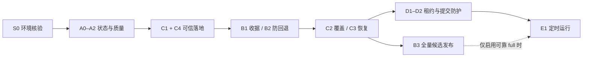

# gr-data 可靠采集实施计划

面向审核范围与顺序的维护者，以及后续实现者。状态：**通用协议仍待评审，Tushare 最低导入门禁与米筐风险模型 2a 已限定落地**；本文修订不授权新的实现、供应商调用、工作库迁移或部署。

核对日期：2026-10-28，静态核对源码、DDL、测试与已确认决策，检查本机解释器及测试依赖可解析；未运行业务测试、启动容器或连接数据库／供应商。2026-10-06 的审计结论仅作历史依据。

依据：[可靠采集方案](../../../getrich-design/data-platform/proposals/reliable-pipeline.md)、[历史实现审计](../../../getrich-design/archive/data-platform/reviews/2026-10-06-implementation-audit.md)、[一期数据集清单](../../../getrich-design/data-platform/portfolio-diagnosis-phase1-datasets.md)。相邻仓库链接用于本地双仓布局；当前采集进度见 [NOTES](../../.agents/brain/NOTES.md)，业务缺口见 [backlog](backlog.md)。

## 1. 当前基线与边界

成功标准是目标范围的质量、覆盖、提交结果和水位可核验，退出码为 0 只是一项信号。保留 raw → Parquet → ingest → PostgreSQL／TimescaleDB、单表单一来源、COPY／UPSERT 及现有 CLI，不另建行情主库或编排平台。

| 已有能力 | 适用范围与尚缺部分 |
| --- | --- |
| Tushare 最低导入门禁 | 已有损坏文件硬失败、所选月份必需分区检查、未知代码拦截、硬／软分级及失败流水；尚无统一 A0 状态模型、quarantine、完整开始记录／本地 spool，也未推广全部供应商 |
| 米筐风险 2a | 迁移 049 已提供 variant 用途、整包收据、run 绑定和观察级 capture／import 检查点；`factor.risk_bundle` 覆盖五件套及覆盖表。不是连续日期水位、通用 B1、B2 防回退或 B3 全量切换 |
| 米筐观察恢复 | 补充链路已有不可变观察、哈希、拆片及配额暂停；风险链路复用完整模型日，失败日以新 observation 重抓，不能声称已支持通用 chunk 续传 |
| CLI 提交结果区分 | 已有失败、软告警及提交后停止语义；米筐 ingest 的退出码 `4` 表示已提交但发布资格不满足，`5` 表示事务退出异常后暂停，结果可能已确认提交或仍未知，须结合 outcome 核对，不能一律记失败或宣称已回滚。具体以 [cli.py](../../packages/gr-data/src/gr_data/cli.py) 为准 |
| 认证边界 | [D-020](../../.agents/brain/DECISIONS.md#d-020) 已默认关闭 mock、限制仅 dev 显式开启，无效 JWT 不回退请求头；远端权限与网络边界仍需专项验收 |

原 S0“解释器失效、缺测试依赖”不再作为当前阻塞。S0 保留为每台目标机的前置核验；本次依赖检查不代表测试通过或服务可用。

**运行分工已确认**：iMac 为唯一正式采集／入库主端，Air 用于远程开发与隔离测试；迁移及切换仍待验收。存储、部署和备份目标按 [iMac 迁移计划](imac-collector-migration.md)核对，不在本计划重新选择主机或写入机器路径。

## 2. 实施顺序

保留原任务编号，按依赖推进，不再混用设计阶段编号和严重度。以下均为通用协议的剩余工作；涉及已有链路时先复用并验证兼容性。

B1／B2 的接口在 A0 定义，闭环依赖 C1／C4 的可信文件与分区身份。D、E1 不以 B3 为通用前提；首期可只开放逐分区增量／补数，可靠 full 在 B3 验收前禁用。既有 `--mode init` 不自动等同于全量原子发布。

### A. 环境、状态与质量

| 任务 | 剩余工作与落点 | 完成条件 |
| --- | --- | --- |
| S0 环境核验 | 使用现有 uv lock 核验解释器与依赖；逐项检查所选测试的 fixture 依赖。`tests/conftest.py` 的 `pg_dsn`／`pg_conn` 被请求时会启动容器、迁移并 TRUNCATE 隔离库，不能仅凭 marker 或环境开关认定离线 | 离线用例只依赖 Fake SDK／临时文件；PG 用例明确使用隔离实例，记录实际通过、跳过和未验证范围 |
| A0 契约冻结 | `cli.py`、`common/quality.py`、`ingest/base.py`；依赖 S0。区分 process_status 与 data_status，统一 run／attempt／partition 身份、expected／actual／rejected 计数、hard／soft 规则及退出码映射；选定首批 dataset | 合法空、未到发布窗口、部分覆盖、硬失败与提交结果未知可区分；兼容已有 CLI 调用方及米筐已提交后停止语义 |
| A1 质量推广 | `common/parquet.py`、provider adapter／importer；依赖 A0。推广严格读取与覆盖检查，损坏文件隔离并保留证据，build 丢行进入结构化质量结果 | 不将损坏当缺失；hard fail 拒写，soft 明确降级；source／accepted／rejected 可对账，未知代码和缺分区有定位信息 |
| A2 运行账本 | `ingest/__init__.py`、`ingest/base.py` 及 gr-db 迁移；依赖 A0。补独立短事务的开始、失败与真实耗时，覆盖 build／挂载／配置预检失败；PG 不可达时写有界本地事件 spool | 主事务回滚后仍有失败证据；恢复后幂等汇入。spool 仅存脱敏事件，不成为第二套采集计划、水位或业务提交账本 |

A0 的逻辑状态沿用设计 §6：process_status 包含 queued、running、deferred、raw_ready、importing、succeeded、partial、blocked、failed、abandoned；data_status 区分 complete、valid_empty、degraded、partial、waiting、blocked。迁移与现有状态映射需在实现前审阅，不直接替换现行数据库枚举或 CLI 约定。

### C. 可信落地、覆盖与恢复

| 任务 | 剩余工作与落点 | 完成条件 |
| --- | --- | --- |
| C1 raw-first 标准化 | `raw/ricequant/{store,riskmodel,risk_dynamic}.py`、`common/{parquet,paths}.py`、Tushare fetcher／adapter；依赖 A0。版本化 manifest，登记身份、精确范围、aware 时间、质量、文件哈希／schema、分页拆片及 producer 版本，字段定义见设计 §5.1。Tushare 新格式采用不可变日分片，月文件降为可重建兼容视图 | 同文件系统临时写、文件 fsync、校验读回、不可变路径发布、目录 fsync，最后持久化 manifest；孤儿／partial 文件不可消费。旧 raw 保留，缺字段不能伪造完成证据 |
| C4 存储保护 | `common/paths.py` 与运行预检；依赖 A0，与 C1 同批。核验 storage_id、sentinel、realpath、挂载及容量；本地 spool 单独设有限目录 | 外盘未挂载、错误卷、路径越界或空间不足时拒绝写入，不在系统盘创建同名替代目录，不删唯一证据；在实际文件系统验证 rename／fsync／锁语义 |
| C2 覆盖与模式 | raw planner、provider fetcher；依赖 C1、B2。明确 full／incremental／backfill／reconcile 的范围，按交易日、生命周期、分页与发布截止识别洞集；标的和日历只有完整 scope 才可差集删除／撤销 | 最新分区存在也能发现旧月缺日；未发布、合法空、截断与缺数可区分；历史修订有新观察及影响范围。停复牌空响应与整月时间刷新问题纳入此阶段 |
| C3 replay 与预算 | raw 入口、米筐轮次／journal、ingest manifest 消费；依赖 B1、C1、C2。扫描已落地未 receipt 的观察，复用链路允许的完整单元，明确失败日／片的重试边界，按端点与账号控制预算 | 文件成功库失败只重导；已完成单元不重复耗费额度；恢复不丢原失败证据。现有风险专用执行器的人工复核暂停不得被通用调度绕过 |

C1 上线前核算不可变观察的增长及保留预算；清理协议未验收前不删除唯一副本。日线／分钟保持不复权主存，复权修订关联数据版本；财报保留发布、观察及修订时点。分钟／财报及尚未准入 writer 的启用不包含在本计划中。

### B. 收据、防回退与发布

| 任务 | 剩余工作与落点 | 完成条件 |
| --- | --- | --- |
| B1 通用收据与双水位 | `db/risk_receipts.py`、`ingest/base.py`、`db/copy.py` 及 gr-db；依赖 A、C1、C4。推广 `(target, manifest_hash, importer_version)` 收据，业务 merge、质量、receipt 与 DB 检查点同事务，capture 独立提交；预留 E4 outbox 的原子写入位置 | 同批重放不重写业务；COMMIT 响应丢失按收据核对，确认前不假定回滚或自动继续；观察级检查点与连续完成水位分开 |
| B2 观察版本防回退 | 导入层及代际／分区当前指针；依赖 B1。显式登记 authority epoch、代际顺序与 canonical 分区观察序，事务锁定当前版本并 CAS；不能按 UUID、mtime、到达顺序或不同 variant 的局部序号比较新旧 | 新 B 提交后旧 A 晚到，仅保留历史／记 superseded，不改当前业务值与水位；异地端采用同一权威顺序 |
| B3 可靠 full（可选） | raw planner、候选 staging、发布服务及 gr-db；依赖 B1、B2、C1、C2。冻结 generation，全部必需分区通过后一次发布；评估锁、WAL、峰值空间与读契约，大分钟 full 另审 | 任一片失败，旧可用业务数据不变；发布失败可重放，无半激活代际。未实现时拒绝可靠 full，逐分区 backfill 不宣称全量原子性 |

**先核对现有 DDL，再设计通用扩展。** 2026-10-29 新库已将风险专用 variant／receipt／checkpoint 归入 `factor`，037 直接建表，049 完成证据触发器；`factor.import_receipt.target` 仍限定 `factor.risk_bundle`。现有记录与 variant、capture、run 绑定建立不可变约束，不直接放宽为全部 provider 的通用收据。通用协议须另审键、状态、公共与领域校验边界及兼容迁移，不能把风险表原样复制后宣称通用。全部 DDL 只放 gr-db，后续不改已部署的基线 SQL，不在 API 启动时建表。

**诊断发布另按 [D-022](../../.agents/brain/DECISIONS.md#d-022) 的 2b 验收**：发布清单钉住组成收据／run，失效与组成写入原子衔接，统一读取在一致性快照内核对；数据库层拒绝 validation run，消费 `publishable=false` 的旧 run 禁用证据。组成变化后旧版本不可复算，不以当前最新数据冒充历史版本；一期不建可变数据版本表，诊断专用角色延后。B2 当前指针、B3 全量切换和诊断发布不是同一能力，正式风险读取保持关闭。

### D. 租约与提交防护

| 任务 | 剩余工作与依赖 | 完成条件 |
| --- | --- | --- |
| D1 跨 run 租约 | `gr_data.jobs` 薄层及 gr-db lease；依赖 B1／B2、C。稳定资源键不含 run_id，跨 variant 写同一 canonical 分区须互斥；同账号 raw 执行流也互斥，账号标识不得泄露凭据。使用数据库时钟、owner、单调 fence 和固定心跳 | 两 run 不能各拿“合法锁”写同一资源；失租旧 worker 即使 SDK 成功返回也不能提交；锁与版本选择的作用域一致 |
| D2 事务所有权 | worker 独占连接，提交事务锁定共享租约并验证 token；dataset 全量排他与分区任务使用固定锁序；依赖 D1 | 超时、重启、心跳丢失、连接中断后可恢复，旧 token 不推进 active／水位；不提交调用方无关事务，也不将自行 commit 的 importer 包装成假原子事务 |

RQ 本地 flock 继续用于文件 writer 互斥，不能替代 PG fencing。D 不依赖 B3；启用 E1 定时前必须通过 D，即使只开一个 worker，手工 CLI 与定时任务也可能竞争。

### E. 运行、监控与备份

| 任务 | 拟实施范围与依赖 | 完成条件 |
| --- | --- | --- |
| E1 唯一调度与补跑 | `gr_data.jobs` 独立 CLI，仓库外 OS 定时器唤起，PG 保存计划／run；依赖 B1／B2、C、D | 同 job 只有一个正式触发源；休眠／断网恢复后按洞集补跑；API 多 worker 不各自启动调度；首期不增加 Redis 或新编排平台 |
| E2 只读监控 | `gr-api` 查询域与 `apps/web` 现有请求层；依赖 A、B1／B2、E1，远端开放还需 E3 | 展示计划、分区、质量、脱敏日志、capture 与 DB 水位；关闭浏览器不影响任务，HTTP 存活不冒充数据健康 |
| E3 远端安全验收 | 复用 D-020 认证修复；验证 JWT、权限、安全头及 TLS／网络边界 | mock 不用于远端正式访问；伪造请求头、过期 JWT、越权请求被拒；管理重试／启停另定授权与审计 |
| E4 告警与健康 | 独立 notifier、PG outbox、本地有界 spool 与异机 watchdog；依赖 E1，outbox 与 B1 提交集成 | 发送去重、合并、有限退避并检查业务码；失败／dead 可见，通知失败不重跑 ETL；主机断网／停机由独立节点发现 |
| E5 异地复制与导入 | 仅复制完成文件／manifest，目标校验后发布 replicated，各 PG 独立 receipt；依赖 B1／B2、C、D | partial／哈希不符不导入；源端删除不传播；提升备用端前隔离旧主并切换 epoch，不自动双活 |
| E6 PG 逻辑备份与恢复 | 仓库外运维，备份目标、保留和 RPO／RTO 单独确认；不以 E5 raw 复制完成为前提 | 使用逻辑导出／恢复，不复制数据库数据目录；隔离还原核对 schema、ownership、数据键、质量、收据／水位与 raw 引用，记录恢复结果 |

## 3. 验收门禁

| 门禁 | 范围与证据 |
| --- | --- |
| G0 范围评审 | 确认本轮阶段、首批 dataset、接口及迁移草案；已有 2a 批准不扩大为通用协议全部获准 |
| G1 离线实现 | Fake SDK、临时文件、故障注入及真实项目断言；确认 fixture 不触发网络／数据库。历史 7 项 stub 复现不替代项目测试 |
| G2 隔离 PG | 按实现任务确定独立 PG／TimescaleDB 与临时 named volume，不连接业务库；验证真实 COPY／JSONB、回滚、收据唯一、CAS、锁竞争及提交结果恢复 |
| G3 受限供应商样本 | 依任务授权限定账号能力、日期与标的；验证实际 schema、单位、合法空、覆盖及预算，不扩大采集或记录凭据 |
| G4 上线与恢复 | 工作库迁移、部署、主源切换及实际备份目标按各自授权执行；验证挂载／重启顺序、隔离恢复、补跑、脱敏告警与 RPO／RTO |

必须覆盖的故障场景：

| 场景 | 通过条件 | 门禁 |
| --- | --- | --- |
| 坏 Parquet、缺分片、丢行、重复页、schema 漂移 | 可定位、可对账；硬失败拒写，partial 不冒充 complete，损坏证据保留 | G1 |
| 未发布、合法空、截断、停牌／生命周期不适用 | 按 dataset 契约判断，不补零、不机械补 bar；空响应有依据 | G1；真实契约 G3 |
| 构建前失败、PG 不可达 | 有 run／attempt 或有界事件，恢复后幂等汇入 | G1／G2 |
| 文件成功库失败、重复提交、COMMIT 响应丢失 | 文件可重放，收据与业务结果一致，不因超时重复抓取或误判回滚 | G2 |
| 旧观察晚到、跨 variant／异地乱序 | 当前值不倒退；A→B→A 三次观察均保留，不按内容哈希合并掉观察历史 | G1／G2 |
| full 任意阶段失败（选择 B3 时） | 旧数据仍可读，候选不半激活；发布重试幂等 | G1／G2 |
| 旧月缺日、历史修订、睡眠／断网、UTC 主机 | 按上海交易日日历识别洞集，修订有新观察，重复唤起不重复运行 | G1 |
| worker 竞争、失租旧 worker 恢复 | 同资源仅一个合法提交者；旧 fence 被拒，固定心跳不伪装业务进度 | G2 |
| 未挂载、错误卷、磁盘满、复制中断／源端误删 | 不误写系统盘，未完成文件不作为 complete 发布，不删唯一副本；源删除不传到备份 | G1；实际环境 G4 |
| 告警失败、主机离线、备份还原 | ETL 不被通知重试牵连；dead 可见；异机发现离线，隔离恢复证据完整 | G1／G4 |

分钟夜盘、日内边界与财报 PIT 在对应能力获准扩展时另做 G3，不由日频样本外推通过。

## 4. 兼容与回滚

| 变更 | 渐进启用与回滚边界 |
| --- | --- |
| 状态／退出码 | 先核对调用方，在选定任务启用；可暂停新调度，但不以忽略 warning 撤销硬质量门禁 |
| manifest／文件布局 | 新格式独立版本／目录，旧 raw 显式只读兼容；关闭新 writer 时保留候选、旧文件及审计证据，不反向覆盖旧格式 |
| ops／schema | 优先兼容扩展，先隔离验收，再按授权迁移工作库；回退先停止 worker／关闭入口，DDL 逆迁移另审，不删除既有 receipt／绑定 |
| generation／读契约 | 只有旧代际业务数据仍可读且验证一致时才切回；若数据已被 UPSERT 覆盖，仅修改 active 指针不能恢复旧值 |
| 主机切换 | 停旧调度、处理在途 run、隔离旧 worker，再转移权威；保持单 writer，缺隔离能力则备端只读 |

## 5. 剩余范围决定

1. 通用协议本轮实施到哪一阶段；建议先 S0、A、C、B1／B2 与隔离验收，D／E 分阶段，明确是否选择 B3 或暂不开放可靠 full。
2. 首批升级协议的数据集、日频范围与受限验收区间；不自动把分钟、财报或未准入的米筐补充数据列入实施。
3. 数据新鲜度、异机告警、RPO／RTO、备份目标与保留预算；主机角色沿用已确认的 iMac 分工，不重复待决。

这些决定用于确定后续实现范围。本次只更新文档，不启动新的采集、调度、外部通知或部署。
